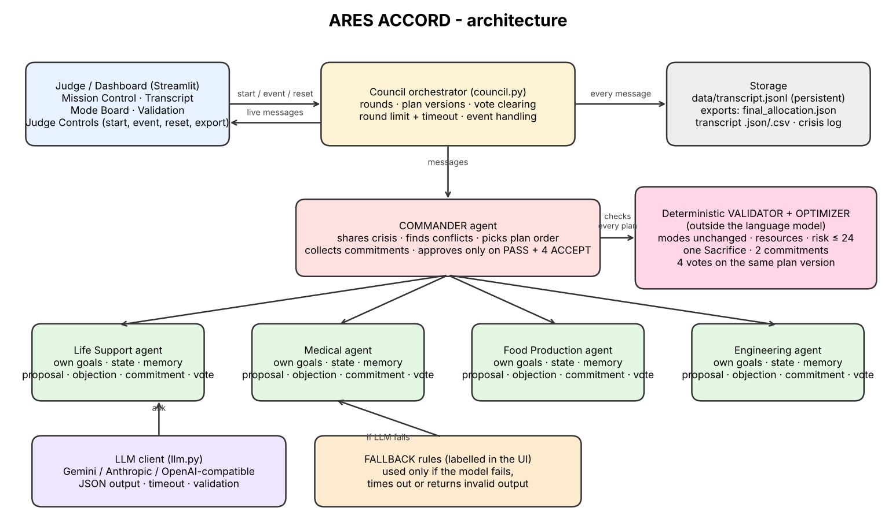

# ARES ACCORD – Multi-Agent Resource Negotiation

Five agents (Commander, Life Support, Medical, Food Production, Engineering) negotiate a shared resource pool
after a micrometeorite storm. A deterministic validator outside the language model checks every plan, and the
Commander approves only after **validator PASS + four ACCEPT votes on the same plan version**. A judge can inject
a new crisis from the dashboard (no code change) and the council renegotiates.



## How it works
1. **R1** Commander publishes the crisis; each department requests a mode and explains what it would lose.
2. **R2** Commander reports the numeric conflict (resources, risk, sacrifice count); departments revise.
3. **R3** The optimizer (`solver.py`, brute force over all mode combinations) lists valid plans; the Commander
   picks which to try first. The sacrificing department can **refuse**; other agents are asked for **return
   commitments**; a new plan version replaces the draft and clears votes.
4. **R4** Validator checks the plan → all four departments vote on that version → Commander approves, or the next
   candidate plan is tried until the round limit / time budget (then `DEADLOCK` / `TIMEOUT`).
5. If no plan exists, the result is **INFEASIBLE** with the blocking constraints and the extra resource needed.
6. **Events**: the judge enters resource changes (absolute or %), the old plan becomes `STALE`, commitments are
   reviewed, the Commander may invoke the **Crisis Override** (risk 28, two Sacrifice modes), and agents negotiate
   again. Fresh votes on the new version are required.

Agents get their own goals, constraints and message memory (`agents.py`). Each decision is an LLM call returning
JSON that is validated; if the model fails, times out or returns something invalid, a simple rule-based fallback
answers and the message is **labelled `fallback-rules`** in the UI, transcript and exports.

## Files
| File | Purpose |
|---|---|
| `app.py` | Streamlit dashboard (Mission Control, Council Transcript, Mode Board, Validation, Judge Controls) |
| `council.py` | Orchestrator: rounds, plan versions, votes, events, override, exports |
| `agents.py`, `llm.py` | Agent roles/memory and the small LLM client (Gemini, Anthropic, OpenAI-compatible) |
| `validator.py`, `solver.py` | Deterministic checks and the optimizer |
| `config.json` | Resource pool, mode packages, limits, return agreements (nothing hardcoded elsewhere) |
| `run_headless.py` | Runs a scenario without the UI and writes evidence files |
| `test_ares.py`, `test_council.py` | Tests |
| `evidence/` | Opening log, post-event log, final plan, transcript |

## Setup and run (Ubuntu / macOS)
```bash
python3 -m venv .venv && source .venv/bin/activate      # Windows: .venv\Scripts\activate
pip install -r requirements.txt
cp .env.example .env        # then put ONE API key in .env (see model choices)
streamlit run app.py        # opens http://localhost:8501
```
**Reset:** press **Reset** in the sidebar (keeps transcript history) or **Clear history** (deletes `data/`).
Without an API key the app still runs, in clearly labelled fallback mode.

## Using the dashboard
1. Check or edit the resource pool in the sidebar, press **Start scenario**; watch the live transcript.
2. Open **Mode Board**, **Validation**, **Council Transcript** (all scenarios are kept).
3. Inject an event (preset, free text like `Power decreases by 4`, exact changes/percentages, or pasted JSON in the
   starter-kit format) and press **Inject event**.
4. **Export**: `final_allocation.json`, transcript JSON/CSV, crisis log, opening log.

## Model choices
Any one of: Gemini (`GEMINI_API_KEY`), Anthropic (`ANTHROPIC_API_KEY`, default `claude-haiku-5-5`), or any
OpenAI-compatible endpoint (`OPENAI_API_KEY`, optional `OPENAI_BASE_URL`, e.g. Groq or a local server). Model names
can be changed with `*_MODEL` variables. One shared model plays all five agents; roles, goals, memory and
message history are separate per agent.

## Tests
```bash
python3 test_ares.py      # validator + solver (16 checks)
python3 test_council.py   # negotiation, event, INFEASIBLE, fallback, exports (10 checks)
```
The LLM code path is tested with a stand-in function patched in the tests only; the app itself never fakes a model.

## Known limitations
- `output_schema.json` in the starter kit uses generic fields (`oxygen_units`, `water_liters`, `power_kwh`,
  `food_rations`, `APPROVE`) that do not match the guide's five resources and `ACCEPT`. `final_allocation.json`
  includes per-agent records in that shape (`food_rations` is `null`; our fields are added next to it; `ACCEPT`
  is written as `APPROVE`; `risk_score` is the total plan risk).
- `flag_human_review` is set when total risk > 20, but there is no blocking human-approval step (bonus not done).
- Event `duration_hours` is recorded but the pool is not automatically restored after the duration.
- Candidate plans come from the brute-force optimizer; departments influence the outcome through refusals,
  commitments and votes rather than by inventing arbitrary allocations.
- State of a running scenario lives in the browser session; the transcript is persisted in `data/transcript.jsonl`.
